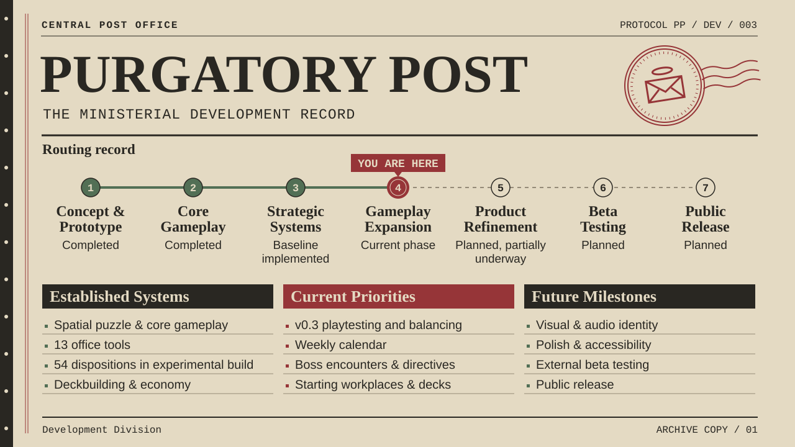

# Purgatory Post

*Every soul has a file. Every file has a deadline.*

## Project Overview

Purgatory Post is a puzzle roguelite and deckbuilder set in the bureaucratic offices of Purgatory. You have one working week to keep an afterlife post office running. Each delivery brings more files to your desk, but never more space. Sometimes the best use of a stamp is to finish a file; sometimes it is to move the file out of the way.

## Core Gameplay

- **Make room on a 4×4 desk.** Each file has a Sin, a Fate and one or more pages. Grouping compatible files frees space, but the file you need next may end up underneath another.
- **Spend office minutes.** Tools are cards in your hand. They let you move, reclassify or process files. A move that sets up a combination also brings the next delivery closer. The game shows when it is due.
- **Build for the rest of the week.** Completed files earn credits. Between days, you can buy Tools, improve individual cards or desk spaces, and acquire lasting rules called *Dispositions*. One can turn the ordinary Red Stamp into a way of processing several compatible files in a stack. The same desk can reward a different decision depending on what you have bought.

## Project in Numbers

| | v0.2 baseline | v0.3 private playtest |
|---|---:|---:|
| Distinct Tools | 12 | 13 |
| Implemented Dispositions | 20 | 54 |
| Working days per run | 5 | 5 |
| Desk spaces | 16 | 16 |

The v0.3 counts refer to implemented content in the experimental build, not to a public release. Balance and usability are still being tested.

## Development Approach

I design and playtest the game. I write down what a change should do, what it must leave untouched and how to check the result. AI assists with implementation and automated tests. Playing through the changed situation answers a different question: even if the rule works, does the player have enough information to make a decision?

## Case Study

[Read the product development case study](CASE-STUDY.md) for three decisions behind the game: what a second look at the shop should cost, where a player should choose a file stack, and how to expand the rule set without paying twice for the same work.

## Development Roadmap

[Explore the seven-stage development roadmap](ROADMAP.md). It separates milestones already reached from current pre-beta work and planned testing.

## Project Status

In active pre-beta development and private playtesting. This repository is a project portfolio: the source code is private, and no playable demo is being released to the public at this stage.
